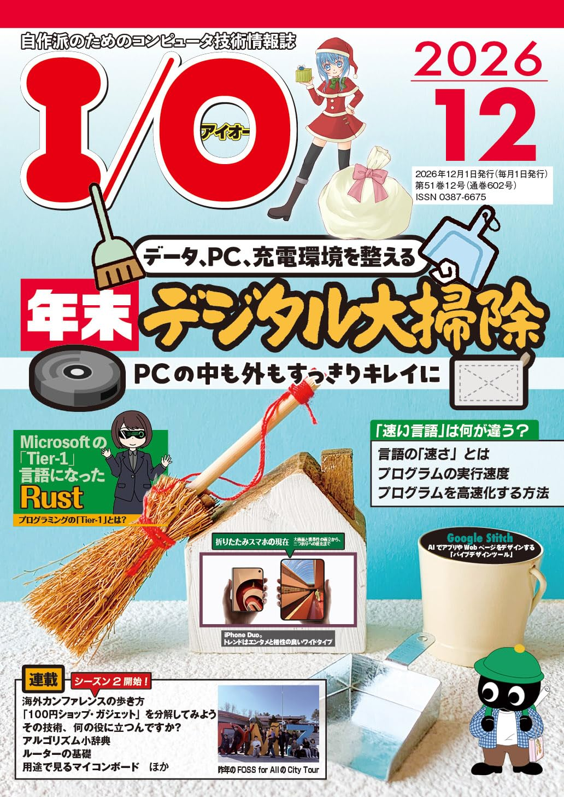
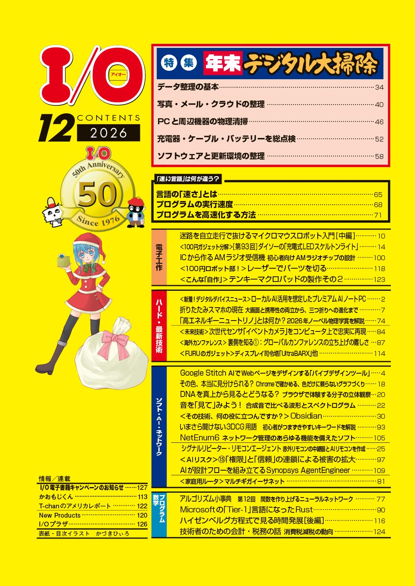
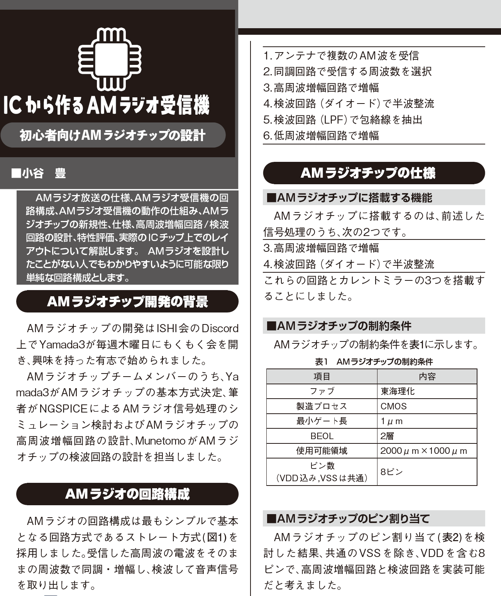

# [月刊I/O 2026年12月号](https://www.amazon.co.jp/dp/B0HPLDXDR7/)にて連載記事「ICから作るAMラジオ受信機ー初心者向けAMラジオチップの設計ー」が掲載されます

今月号も「[ISHI会版OpenMPW OpenSUSI-TR10-1～2026年OpenSUSI-TR10（OpenSUSI-TR1umシャトル）の相乗り～](https://ishi-kai.org/openmpw/shuttle/opensusi-tr10/2026/09/25/shuttle_ISHI-Kai_OpenMPW-OpenSUSI-TR10-1_submitted.html)」に投稿されたいろいろな回路の紹介となります。  
今回は、AMラジオチームの小谷豊氏によるICから作るAMラジオ受信機ー初心者向けAMラジオチップの設計ーとなります。  
アナログ系の応用回路が複数詰め込まれていますので、アナログ回路に興味のある人は、ぜひ、ご覧ください！  

- [ISHI会版OpenMPW OpenSUSI-TR10-1のgithub](https://github.com/ishi-kai/ISHI-KAI_Multiple_Projects_OpenMPW_OpenSUSI-TR10-1)

## [月刊I/O 2026年12月号](https://www.amazon.co.jp/dp/B0HPLDXDR7/)
* [Amazon](https://www.amazon.co.jp/dp/B0HPLDXDR7/)
* [楽天ブックス](https://books.rakuten.co.jp/rb/18891194/)

    
    
    
