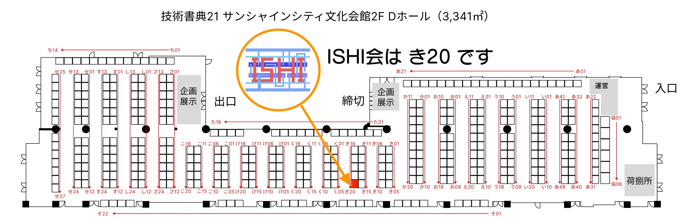

# 「[Open Source Silicon Magazine vol.3 ーはじめの一歩のその先へー～次世代電子工作への第一歩！マイコンチップを自作しよう！（ロジック（デジタル）編）～](https://techbookfest.org/product/r3vfaRi837Wxvr9BQWKUtr)」を技術書典21で頒布します！
セガの至高のゲーム機・セガサターンの頭脳であるCPU：SHマイコンの最初期の開発チームのメンバーでありSHマイコン用パイプライン・シミュレーター「shsim（通称Sherry）」の開発者である山崎尊永氏（ペンネーム：圓山宗智）により、その知識を後進に継承するために作った学習用完全チューリング・マシンCPU：bfCPUを実チップとしての設計・製造するための解説本です。  
これまでの書籍のように、FPGAやブレッドボード上にディスクリート部品で組むのではなく、実際の半導体ICチップとして製造するための設計の基本から製造方法までを一冊にまとめました！あたなも、自分だけの本物の半導体CPUを作ってみませんか？？？  
さらに、本書購入特典として、SHマイコンの開発リーダーである河崎俊平氏と本書の執筆者である山崎尊永氏（ペンネーム：圓山宗智）の特別対談動画の限定公開URLをつけていますので、ぜひ、当時のストールマンやセガとの裏話やSHマイコンの進化の行きつく先を目撃してください！  

SHマイコンの開発秘話については「[SuperH開発ストーリー](https://sh.swhwc.com/superh/)」も併せてご一読ください。  

また、会場のみですが、Vol.2の購入履歴や本自体を提示した場合は割引がありますので、ぜひ、Vol.2をご持参ください！！！  

## ロジック/デジタル回路の半導体設計を学ぶ必要はあるのか？
ロジック/デジタル回路の半導体設計は、もうFPGAでやればよい、参入領域の無い技術だと思っていないでしょうか？実は、新しいパラダイムシフトが起きるかもしれません。それは、Cerebras Systems社のWSE（Wafer Scale Engine）です。一言で言えば「シリコンウエハ（丸ごと1枚）を小さく切り分けず、そのまま巨大な1枚の超巨大チップとして動かす」という画期的なプロセッサです。これにより、下記のような利点があり、今までのCPUとは全く違った発想の設計が必要となるレベルのパラダイムシフトが起きようとしてます。そこで、この次世代のCPUへ対応するため、CPUの基礎やロジック/デジタル回路の半導体設計技術を今こそ身につけるべきなのです！

* 「メモリの壁（フォン・ノイマン・ボトルネック）」の破壊
    * WSEはコアのすべてに超高速なSRAM（オンチップメモリ）を直接組み込んで配備している。これにより、データ移動の遅延（レイテンシ）がほぼゼロになり、桁違いのデータ供給能力を実現している。
* 「チップ間通信」のボトルネック排除
    * 1枚のシリコン上でコアがオンチップの「2Dメッシュネットワーク」で連結されている。外部通信ネットワークを経由しないため、通信速度は数百倍速く、遅延は数千分の1に抑えられる。
* 分散並列処理プログラミングの「複雑さの完全解消」
    * 「単一の超巨大なデバイス」として機能するため、「1枚の巨大なプロセッサでデータ並列だけを行う」という非常にシンプルなコード（数行～数十行の設定）で数兆パラメータモデルの学習が可能になる。

前々作の「[Open Source Silicon Magazine Vol.1 ーはじめてのIC設計ー](https://techbookfest.org/product/3W7W1ukgkMrX6ENeBJaaYn)」は無料頒布中！  
前作の「[Open Source Silicon Magazine vol.2 ーはじめの一歩のその先へー～電気系ものづくりYouTuber イチケン氏降臨！次世代電子工作の第一歩！マイコンチップを自作しよう（アナログ編）～](https://techbookfest.org/product/16QdT05XCLVsRDi1fqX2wy)」は有償頒布中！

みどころに関しては、[電気系ものづくりYouTuber イチケン氏]( https://www.youtube.com/@ICHIKEN1 )に書いていただいた "まえがき" に詰まっておりますので、下記を参照してもらえればと思います！  
また、イチケンさんが挑戦したオペアンプ「[オペアンプを『半導体回路から自作』してみた【オープンソース半導体】](https://www.youtube.com/watch?v=maJQiwuKzZM)」の解説あります。  

- 

## サークル出展
* 日時
    * 2026/11/23
* 場所
    * 池袋・サンシャインシティ 展示ホールD（文化会館ビル2F）
* ブース番号
    * き20
* タイトル
    * 【既刊】Open Source Silicon Magazine vol.2 ーはじめの一歩のその先へー～電気系ものづくりYouTuber イチケン氏降臨！次世代電子工作の第一歩！マイコンチップを自作しよう（アナログ編）～
    * 【新刊】Open Source Silicon Magazine vol.3 ーはじめの一歩のその先へー～次世代電子工作への第一歩！マイコンチップを自作しよう！（ロジック（デジタル）編）～
    * 【合本】Open Source Silicon Magazine vol.2 & vol.3セット（会場のみ）
* サポートサイト
    * [GitHub上のOpenSourceSiliconMagazine公開サイト](https://github.com/ishi-kai/OpenSourceSiliconMagazine/tree/main/Vol.3/)
* 価格
    * Vol.2単体
        * 電子版のみ
            * 2000円
        * 紙版のみ（会場のみ）
            * 2500円
        * 紙版＋電子版のセット
            * 2500円
    * Vol.3単体
        * 電子版のみ
            * 1500円
        * 紙版のみ（会場のみ）
            * 1500円
        * 紙版＋電子版のセット
            * 1500円
    * Vol.2の購入履歴やVol.2本を提示した場合のVol.3単体（会場のみ）
        * 電子版のみ（会場のみ）
            * 1000円
        * 紙版のみ（会場のみ）
            * 1000円
        * 紙版＋電子版のセット（会場のみ）
            * 1000円
    * Vol.2＋Vol.3セット（会場のみ）
        * 電子版のみ（会場のみ）
            * 3000円
        * 紙版＋電子版のセット（会場のみ）
            * 3000円

## 電子版
* [技術書典21](https://techbookfest.org/event/tbf21)
    * 【既刊】[電子版(PDF&epubのセット)：Open Source Silicon Magazine vol.2 ーはじめの一歩のその先へー～電気系ものづくりYouTuber イチケン氏降臨！次世代電子工作の第一歩！マイコンチップを自作しよう（アナログ編）～](https://techbookfest.org/product/16QdT05XCLVsRDi1fqX2wy) 
    * 【新刊】[電子版(PDF&epubのセット)：Open Source Silicon Magazine vol.3 ーはじめの一歩のその先へー～次世代電子工作への第一歩！マイコンチップを自作しよう！（ロジック（デジタル）編）～](https://techbookfest.org/product/r3vfaRi837Wxvr9BQWKUtr) 
* Amazon
    * 【既刊】[Kindle版：Open Source Silicon Magazine vol.2 ーはじめの一歩のその先へー～電気系ものづくりYouTuber イチケン氏降臨！次世代電子工作の第一歩！マイコンチップを自作しよう（アナログ編）～](https://www.amazon.co.jp/dp/B0GT4JVSGG) 
    * 【新刊】[Kindle版：Open Source Silicon Magazine vol.3 ーはじめの一歩のその先へー～次世代電子工作への第一歩！マイコンチップを自作しよう！（ロジック（デジタル）編）～](https://www.amazon.co.jp/dp/B0HNTLK1B5) 

## 紙版＋電子版のセット
* [技術書典21](https://techbookfest.org/event/tbf21)
    * 【既刊】[電子版(PDF&epubのセット)：Open Source Silicon Magazine vol.2 ーはじめの一歩のその先へー～電気系ものづくりYouTuber イチケン氏降臨！次世代電子工作の第一歩！マイコンチップを自作しよう（アナログ編）～](https://techbookfest.org/product/16QdT05XCLVsRDi1fqX2wy) 
    * 【新刊】[電子版(PDF&epubのセット)：Open Source Silicon Magazine vol.3 ーはじめの一歩のその先へー～次世代電子工作への第一歩！マイコンチップを自作しよう！（ロジック（デジタル）編）～](https://techbookfest.org/product/r3vfaRi837Wxvr9BQWKUtr) 

前々作の「[Open Source Silicon Magazine Vol.1 ーはじめてのIC設計ー](https://techbookfest.org/product/3W7W1ukgkMrX6ENeBJaaYn)」は無料頒布中！  
前作の「[Open Source Silicon Magazine vol.2 ーはじめの一歩のその先へー～電気系ものづくりYouTuber イチケン氏降臨！次世代電子工作の第一歩！マイコンチップを自作しよう（アナログ編）～](https://techbookfest.org/product/16QdT05XCLVsRDi1fqX2wy)」は有償頒布中！

## 販売ページ
### 電子版
* [技術書典21](https://techbookfest.org/event/tbf21)
    * 【既刊】[電子版(PDF&epubのセット)：Open Source Silicon Magazine vol.2 ーはじめの一歩のその先へー～電気系ものづくりYouTuber イチケン氏降臨！次世代電子工作の第一歩！マイコンチップを自作しよう（アナログ編）～](https://techbookfest.org/product/16QdT05XCLVsRDi1fqX2wy) 
    * 【新刊】[電子版(PDF&epubのセット)：Open Source Silicon Magazine vol.3 ーはじめの一歩のその先へー～次世代電子工作への第一歩！マイコンチップを自作しよう！（ロジック（デジタル）編）～](https://techbookfest.org/product/r3vfaRi837Wxvr9BQWKUtr) 
* Amazon
    * 【既刊】[Kindle版：Open Source Silicon Magazine vol.2 ーはじめの一歩のその先へー～電気系ものづくりYouTuber イチケン氏降臨！次世代電子工作の第一歩！マイコンチップを自作しよう（アナログ編）～](https://www.amazon.co.jp/dp/B0GT4JVSGG) 
    * 【新刊】[Kindle版：Open Source Silicon Magazine vol.3 ーはじめの一歩のその先へー～次世代電子工作への第一歩！マイコンチップを自作しよう！（ロジック（デジタル）編）～](https://www.amazon.co.jp/dp/B0HNTLK1B5) 

前々作の[Open Source Silicon Magazine Vol.1 ーはじめてのIC設計ー](https://techbookfest.org/product/3W7W1ukgkMrX6ENeBJaaYn)は無償配布しておりますので、まずはこちらからご覧いただければと思います。
* [Open Source Silicon Magazine Vol.1 ーはじめてのIC設計ー](https://techbookfest.org/product/3W7W1ukgkMrX6ENeBJaaYn)

アナログ回路に興味のある方は、前作の「[Open Source Silicon Magazine vol.2 ーはじめの一歩のその先へー～電気系ものづくりYouTuber イチケン氏降臨！次世代電子工作の第一歩！マイコンチップを自作しよう（アナログ編）～](https://techbookfest.org/product/16QdT05XCLVsRDi1fqX2wy)」もご覧いただければと思います。
* [Open Source Silicon Magazine vol.2 ーはじめの一歩のその先へー～電気系ものづくりYouTuber イチケン氏降臨！次世代電子工作の第一歩！マイコンチップを自作しよう（アナログ編）～](https://techbookfest.org/product/16QdT05XCLVsRDi1fqX2wy)

## 中身
    
    
    
    
    
    
    
    
    
    
    
    
    
    
